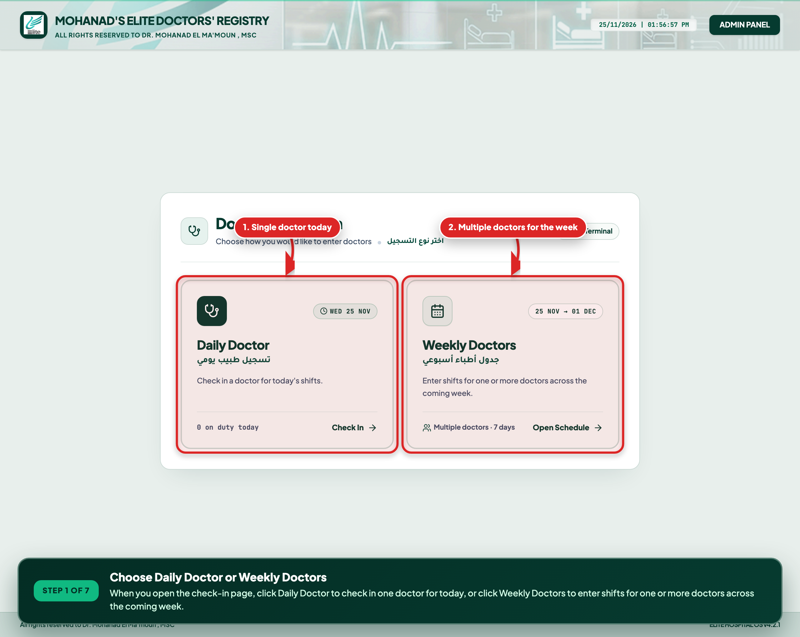
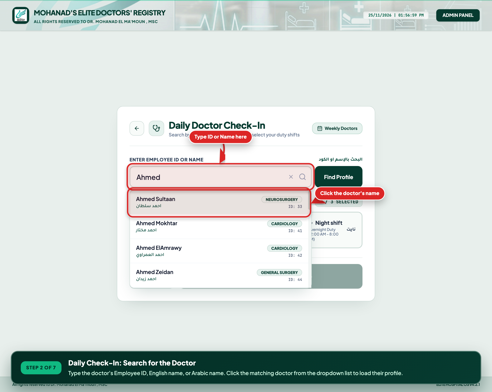
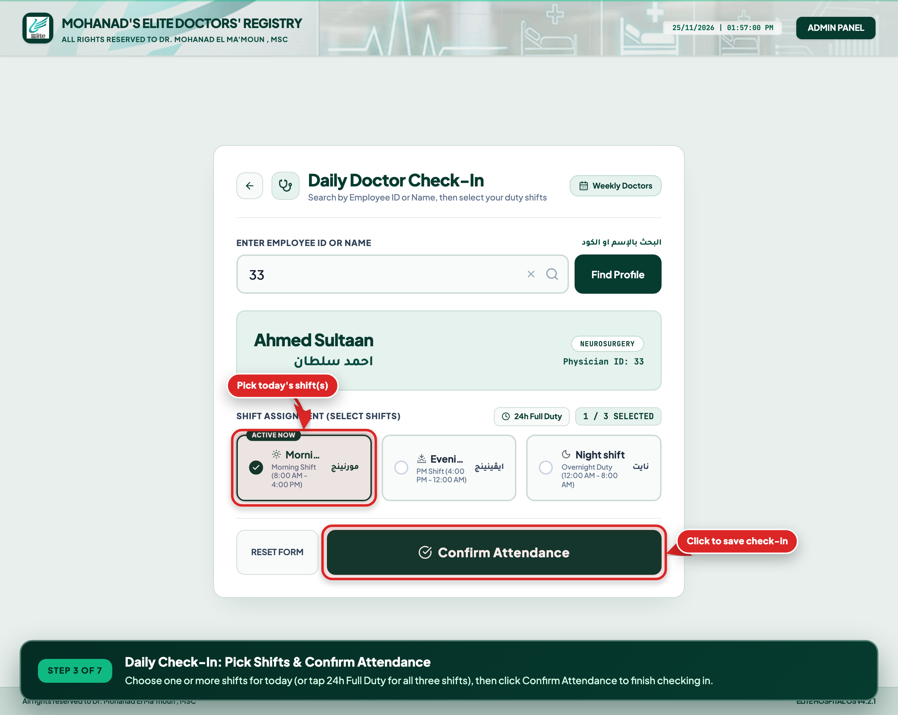
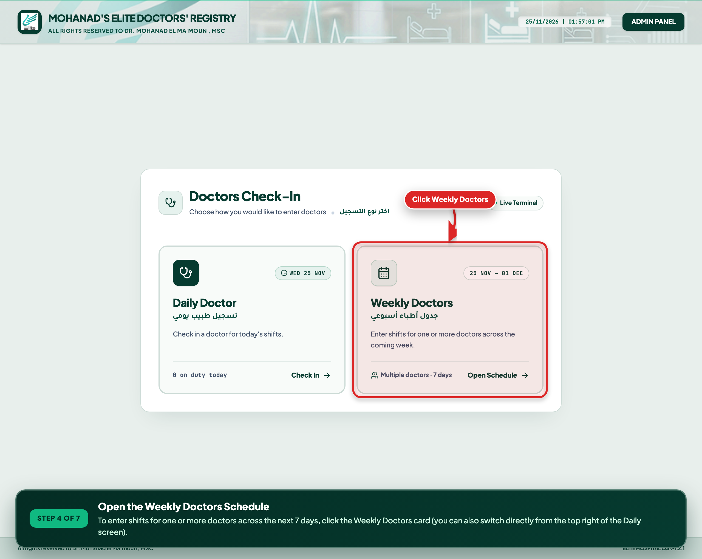
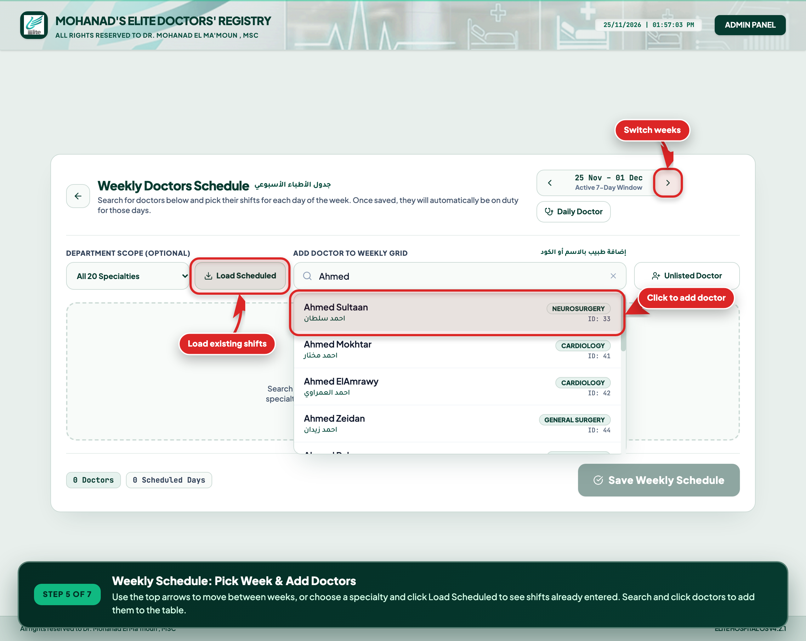
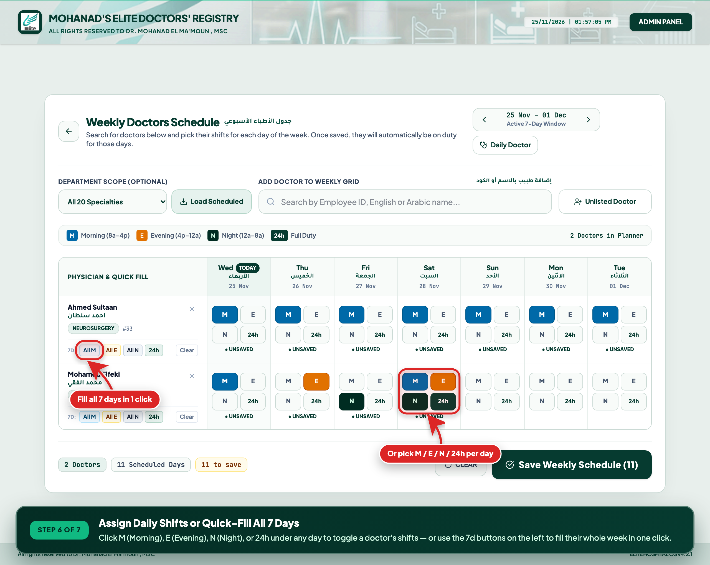
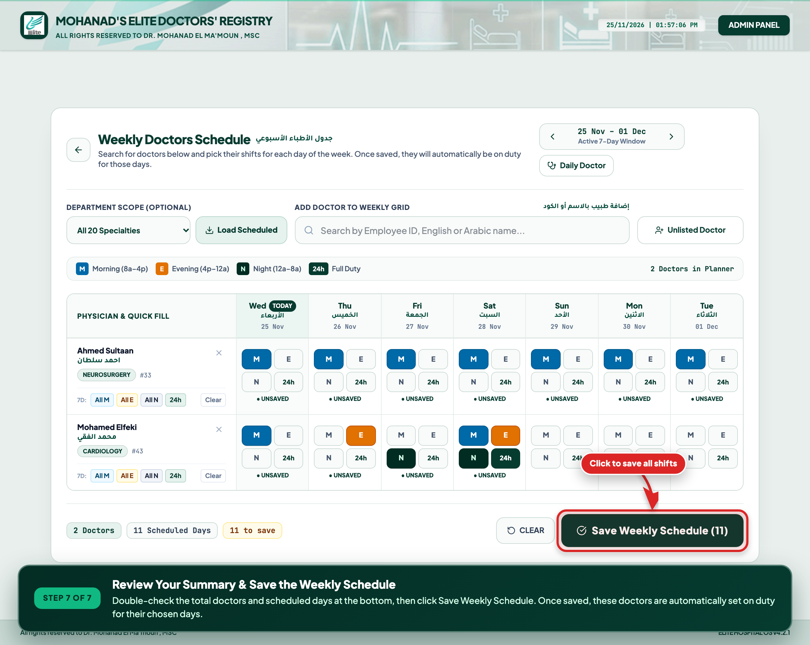

# Doctors Check-In — Step-by-Step Usage Tutorial

This folder contains visual step-by-step screenshots showing how to use both **Daily Doctor** check-in and the **Weekly Doctors Schedule**.

---

### Step 1 — Choose Daily Doctor or Weekly Doctors

When you open the check-in page, click **Daily Doctor** to check in one doctor for today, or click **Weekly Doctors** to enter shifts for one or more doctors across the coming week.

---

### Step 2 — Daily Check-In: Search for the Doctor

Type the doctor's Employee ID, English name, or Arabic name. Click the matching doctor from the dropdown list to load their profile.

---

### Step 3 — Daily Check-In: Pick Shifts & Confirm Attendance

Choose one or more shifts for today (or tap **24h Full Duty** for all three shifts), then click **Confirm Attendance** to finish checking in.

---

### Step 4 — Open the Weekly Doctors Schedule

To enter shifts for one or more doctors across the next 7 days, click the **Weekly Doctors** card (you can also switch directly from the top right of the Daily screen).

---

### Step 5 — Weekly Schedule: Pick Week & Add Doctors

Use the top arrows to move between weeks, or choose a specialty and click **Load Scheduled** to see shifts already entered. Search and click doctors to add them to the table.

---

### Step 6 — Assign Daily Shifts or Quick-Fill All 7 Days

Click **M** (Morning), **E** (Evening), **N** (Night), or **24h** under any day to toggle a doctor's shifts — or use the **7d** buttons on the left to fill their whole week in one click.

---

### Step 7 — Review Your Summary & Save the Weekly Schedule

Double-check the total doctors and scheduled days at the bottom, then click **Save Weekly Schedule**. Once saved, these doctors are automatically set on duty for their chosen days.
